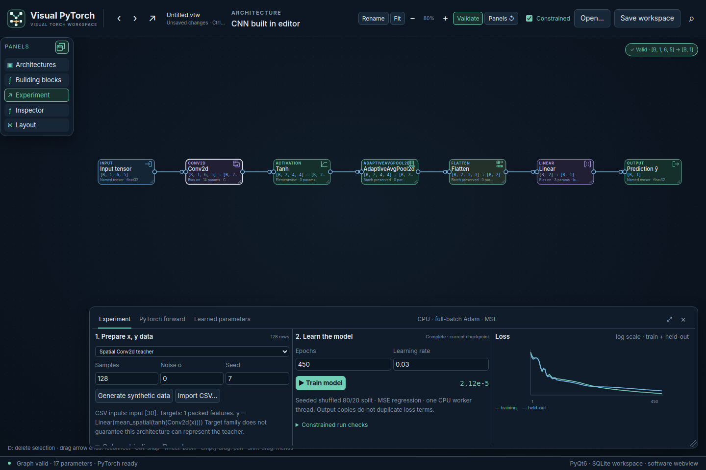
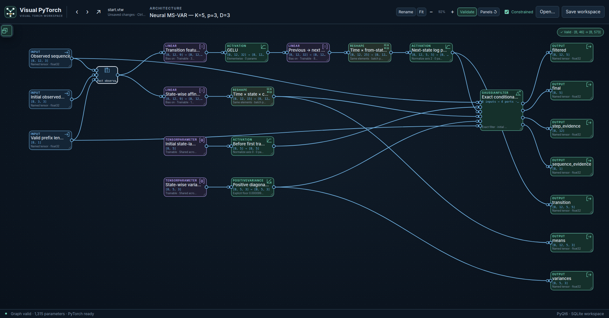
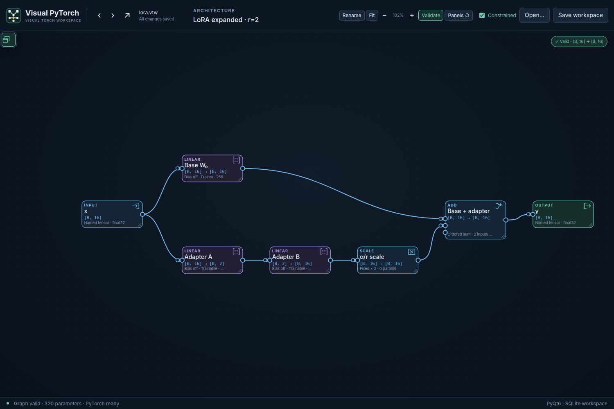
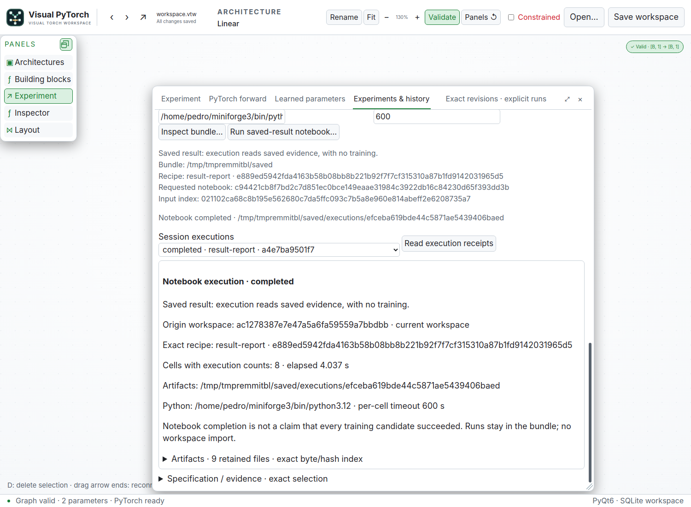
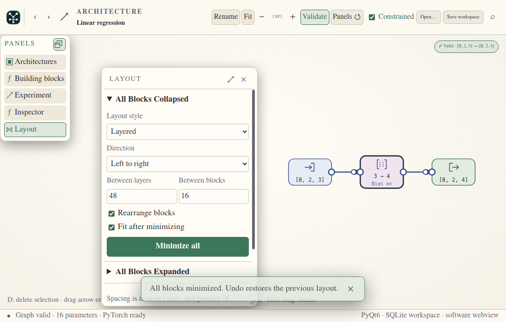
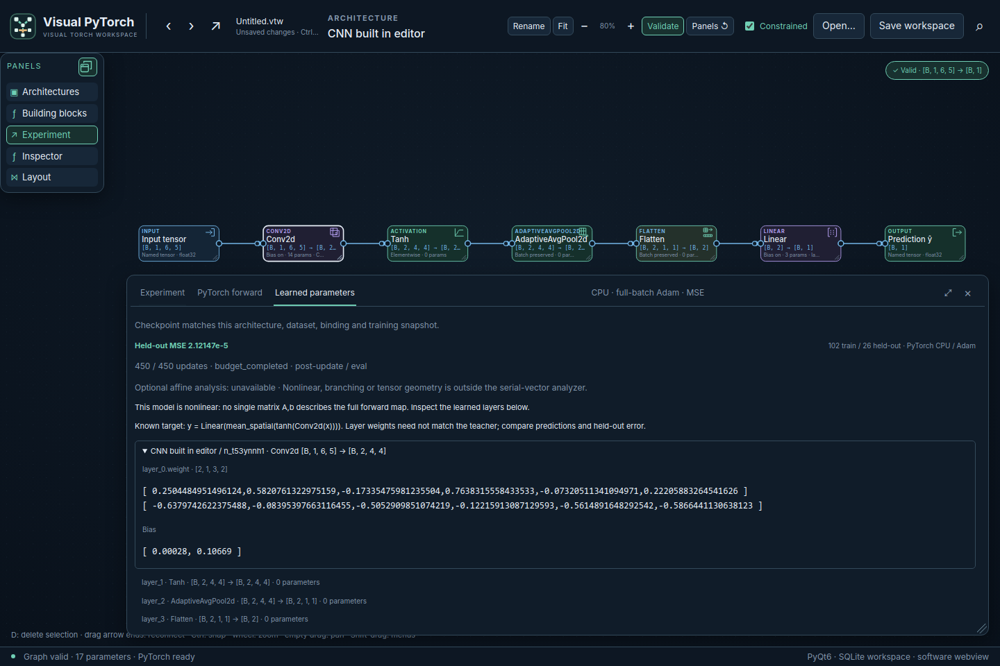
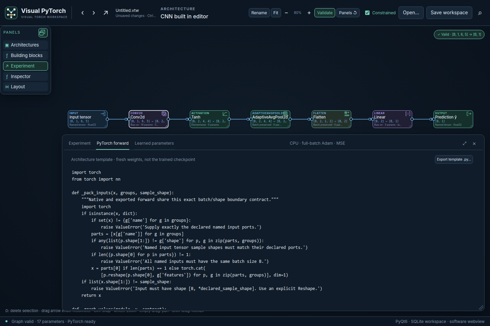

# Visual PyTorch

Draw neural networks. Inspect their tensor paths. Train and export real PyTorch.

Visual PyTorch is a **research prototype**: a Python/PyQt6 desktop application
with an offline WebEngine diagram editor. Try it, tell us what is confusing,
report defects and suggest improvements. It is not a finished experiment platform
or a certified tool for safety-critical work.

**Initial public preview · v0.1.0-alpha.1 · under active construction.**
Source installation is available now; packaged installers are not provided yet.
The tagged preview's numerical workflow is CPU regression, including small CNNs—not a
complete catalogue of trainable architectures. Feedback and independent review
are very welcome. This project is independent of the PyTorch project.

This is openly an **AI-coded, human-and-AI-directed project**. A human defines
goals and evaluates the experience; coding agents contribute implementation,
research and tests. AI assistance is not a guarantee of correctness. We welcome
independent human review and contributions.



This is a real app capture from a small synthetic spatial-regression test:
128 observations, 17 trainable parameters and 450 Adam updates. It demonstrates
the drawing-to-training workflow; it is not a real-world benchmark.

## What works now

- Executable, port-aware graphs: Linear, ReLU/Tanh/Sigmoid/GELU, Reshape,
  Concat, Splitter, Replicator and reusable architecture references.
- Structured CNN regression: Conv2d (including groups), spatial pooling,
  Flatten and Permute, with explicit CHW/axis adapters and learned tensor export.
- Multiple multidimensional inputs, independent branches and ordered joins.
  Tensor validation, shape propagation and generated PyTorch forward code.
- Real CPU PyTorch training with full-batch Adam/MSE, synthetic or CSV data,
  held-out loss and learned parameters. This initial workflow targets regression.
- A compact canvas with floating tools, readable display preferences, many
  themes, independent menu/block spacing, resizable blocks and undo/redo.
- Compact blocks: click a type icon to compact a block, drag that same icon
  to move it, and double-click to restore it. Small dimension/activation labels,
  bias state and ports remain available.
- Layout tools with separate collapsible "All Blocks Collapsed" and "All Blocks
  Expanded" profiles. Minimize/expand all and rearrange automatically, with
  independent direction, layer/block gaps and automatic fitting preferences.
  Layout profiles belong to the `.vtw` workspace and participate in undo/redo.
- `.vtw` SQLite workspaces and an agent-friendly CLI for atomic, revision-checked
  edits. The desktop notices external changes without silently replacing dirty work.

Current development source additionally includes [Softmax with selectable
sample axes](docs/softmax.md), independent dataset/task/experiment objects,
immutable run history, structured minibatch losses, train-only preprocessing,
group/time splits, exact saved predictors/curves and explicit notebook generation
and real-kernel execution. These additions are not included in the initial
`v0.1.0-alpha.1` prerelease. See [Stage C acceptance](docs/stage-c-acceptance.md),
[experiment GUI](docs/experiment-gui.md) and [notebook setup](docs/notebook-reports.md).
The [A–C finalization checkpoint](docs/stage-abc-finalization.md) repairs
split-environment notebook generation: the Qt host need not import Torch or
Jupyter. Choose a report Python with the report dependencies installed; CLI
generation also accepts `--report-python`. That checkpoint is published in main.

Current development source also includes [scoped architecture families](docs/architecture-families.md),
[explicit recurrent graphs](docs/recurrent-graph-contract.md) and
[temporal experiments](docs/temporal-task-execution.md), with exact saved/runtime
provenance and checked standalone export. The bounded A–D roadmap is verified,
including projected/bidirectional LSTM and a complete padded CNN/recurrent example;
see [Stage D acceptance and limits](docs/stage-d-acceptance.md).
Durable detached/remote/distributed execution is deferred and is not included in
this public source. Current development adds the small
[LoRA teaching workspace](docs/lora-workflow.md), executable weight freezing and
initialization, checked inference merging and exact-base adapter export.
Exact neural MS-VAR remains unimplemented. These are development
capabilities, not additions to the initial prerelease. See [development](docs/development.md) and the
[verified first CNN workflow](docs/cnn-workflow.md).
The current local development checkpoint adds [ordered Add and fixed Scale](docs/arithmetic-blocks.md),
shared CLI contract discovery and Ctrl-click output branch selection for insertion.
The LoRA example is a synthetic linear/MLP workflow, not a Transformer benchmark.
New saves use container31; the extension remains `.vtw`. The deferred execution
branch's21/22 files are not accepted by this reader.
Training has a RAM-based admission estimate, not an out-of-memory guarantee.

Open [examples/lora.vtw](examples/lora.vtw) to explore a supplied frozen base,
rank1/2/4 adapters, reusable adapted layers, a two-layer adapted MLP and explicitly
merged inference. The six retained200-update fits and two separately identified
zero-update baselines are real synthetic checks. Saved and fresh-rerun notebooks,
CLI and GUI reproduce the checked rank2 checkpoint; this is not a claim of
general LoRA superiority. See the [workflow and limits](docs/lora-workflow.md).

Open [examples/neural-msvar.vtw](examples/neural-msvar.vtw) for the actual causal
K=5, p=3, D=3 neural MS-VAR: 1,315 learned parameters, unlabelled trajectory data,
exact Gaussian filtering and target-free sequence likelihood. Its twelve-update
fit is a bounded sanity check, not statistical recovery. Native, standalone,
worker and real saved/rerun notebook paths are checked. Reset/execution and
missing-history semantics remain unfinished. See the
[precise computation and limits](docs/neural-msvar-contract.md).





This actual Qt capture shows the initial rank2 graph:256 frozen plus64 trainable
elements. The drawing is an initialization template; its saved training evidence
and explicitly merged inference map are separate artifacts.



This real Qt capture shows a saved-result notebook executed in a fresh kernel:
it reads retained evidence without retraining. Notebook artifacts stay in the
bundle rather than silently changing the workspace. Explicit rerun reports can
train their captured candidate selection instead; generation alone does neither.



## Run

Use Python 3.10 or newer in an environment with Qt WebEngine system dependencies.
Linux is the currently exercised desktop platform; Windows/macOS are unverified.

```sh
git clone https://github.com/phao/visual-pytorch.git
cd visual-pytorch
python -m venv .venv
source .venv/bin/activate
python -m pip install -r requirements.txt
python run.py
```

Open an existing workspace with `python run.py example.vtw`. This is a desktop
app, not a hosted service or a supported standalone browser application.
If Qt fails to start, see [installation and troubleshooting](docs/install.md).
The launcher can use separate Qt and PyTorch interpreters; if necessary, select
the worker with `python -m app.desktop --torch-python /path/to/python`.

On Linux, optional per-user application finder/icon/`.vtw` Open With registration:

```sh
python install_desktop.py --dry-run
python install_desktop.py
```

This registers an Open With candidate, not a forced default. Settings live in
`~/.tensorloon/config.json`; that legacy path is currently retained for compatibility.
Workspaces and preferences are not included in this repository.

## First experiment

Start with Linear regression, or choose MLP regression from Architectures.
Double-click a block to inspect its dimensions and parameters. Connect source
and destination sockets; split paths and rejoin them with Concat when needed.
Open Experiment, generate synthetic data, then Train model. Inspect loss,
learned weights and the PyTorch forward tab.

For a structured CNN example, create a new workspace with
python -m examples.cnn_regression /path/to/new-cnn.vtw, then open it in the app.
It includes explicit Conv2d/Tanh/pooling/Flatten/Linear blocks and synthetic data;
add --train for a bounded one-thread fit before opening. Existing files are refused.

For the richer development workflow, create a new file with
`python -m examples.experiment_workspace /path/to/new-experiments.vtw`, open it,
then select Experiment → Experiments & history. Browse exact dataset/task/model
revisions, preview candidates, run a trial and inspect its retained evidence.
Notebook generation and execution are separate explicit actions and need the
optional environments described in [notebook setup](docs/notebook-reports.md).

For the development temporal workflow, run
`python -m examples.temporal_experiment /path/to/new-temporal.vtw`.
It creates explicit T=3/7 dataset/task cases over one retained recurrent family;
add `--train` for separate bounded CPU worker trials. No implicit state carry,
parameter sharing across trials or automatic padding is inferred.

`A`, `B`, `E`, `I` toggle Architectures, Building blocks, Experiment and Inspector.
`D` deletes the selection; undo/redo repairs accidental edits. Empty canvas
clicks retain selection. Escape cancels a gesture, otherwise clears selection;
with nothing selected it hides the tools. Text fields keep normal editing behavior.
Drag an arrow's destination handle to reconnect it without changing its source.

## CLI and specifications



Inspect learned tensors and predictions, or export a standalone PyTorch model.
The **PyTorch forward** view is a fresh-weight architecture template; trained
export is a separate, identity-checked operation.



```sh
python vpw_cli.py example.vtw init
python vpw_cli.py example.vtw inspect
python vpw_cli.py example.vtw validate ARCHITECTURE_ID
python vpw_cli.py example.vtw export ARCHITECTURE_ID
python vpw_cli.py example.vtw export-trained ARCHITECTURE_ID
```

The CLI returns JSON. Regular export creates a model with fresh weights;
export-trained embeds a matching current checkpoint for inference. The filename
is currently `vpw_cli.py`, while workspace files use `.vtw`.

- [Workspace format and operator specification](docs/vtw-format.md)
- [CLI contract and collaboration](docs/vpw-cli.md)
- [Reusable floating-panel/diagram UI handoff](docs/UI-AGENT-HANDOFF.md)
- [Memory policy and limits](docs/memory-policy.md)

## Tests and contributions

```sh
python -m unittest discover -s tests -p 'test_*.py'
node --test tests/*.test.js
```

Native Qt tests exercise real WebEngine input, not just diagram helpers. See
[contributing](CONTRIBUTING.md) for bounded test commands and privacy rules.
Please use GitHub issues for feedback and pull requests for proposed changes.
Read the [initial release notes](docs/releases/v0.1.0-alpha.1.md) for supported
workflows, verification boundaries and known limitations.

## License

Original project code and documentation are **GPL-3.0-only**, under [GPLv3](LICENSE).
There is no non-commercial restriction. Dependencies retain their own licenses;
see [copyright and dependency notices](COPYRIGHT), including the bundled MathJax.
The software is provided without warranty, as described in the license.
